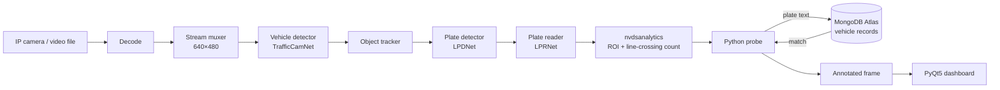

# Edge Video Analytics for Traffic Control on Jetson Nano

Real-time licence-plate recognition, vehicle counting and watch-list flagging, running on an NVIDIA Jetson Nano with an IP camera.

> **Research internship project.** New Era Research and Development Center (N.E.R.D), Addis Ababa, July–September 2021.
> Built by **Leul Mengistu**, **Natnael Getachew** and **Samuel Teshome** under the guidance of N.E.R.D's CTO.
> The source code is kept in a private repository. This page documents the system, my role and the results.

**Demo video:** [ALPR app using NVIDIA DeepStream (YouTube)](https://youtu.be/Wiu7k70ORow)

<!-- TODO: add a 5–10 second GIF or screenshot of the dashboard flagging a car (assets/demo.gif) -->

---

## Motivation

N.E.R.D's longer-term research goal was an intelligent, adaptive traffic-control system. This project built the perception layer for that goal: a system that sees vehicles, reads their plates, counts traffic and flags vehicles of interest in real time, on low-power edge hardware rather than a server.

## What the system does

- Detects vehicles in a live camera stream or a video file
- Counts vehicles crossing a virtual line inside a region of interest
- Locates and reads licence plates
- Checks each plate against a cloud database of registered vehicles (MongoDB Atlas)
- When a plate matches, it saves an annotated frame and shows the vehicle's record on a desktop dashboard
- Through the dashboard, an operator can add vehicle records and search plates manually

## Architecture

The pipeline runs on NVIDIA DeepStream 5.1 (GStreamer). All three neural networks are pretrained NVIDIA TLT models, converted to TensorRT engines so they run on the Jetson Nano's GPU.

## Design decisions

| Decision | Why |
|---|---|
| DeepStream + TensorRT instead of plain OpenCV inference | Three networks in a row is too heavy for the Nano's CPU. DeepStream keeps frames in GPU memory and batches inference. |
| Pretrained TLT models (no custom training) | We had no labelled local dataset and only a few weeks, so we focused on integration and deployment. |
| Detector → plate detector → plate reader cascade | Searching for plates only inside vehicle boxes is cheaper and more accurate than searching the whole frame. |
| Confidence filter (> 0.90) and sampling every 30th frame | Cuts down database lookups and false matches. |
| Cloud database with a desktop dashboard | Lets non-technical operators (e.g. traffic police) manage the watch list. |

## My contribution

I worked jointly with Natnael Getachew and Samuel Teshome and took part equally in every part of the project:

- Setting up the Jetson Nano (JetPack, DeepStream 5.1) and converting the LPR model to a TensorRT engine
- Adapting NVIDIA's DeepStream Python sample into a vehicle → plate → text pipeline
- The probe logic: confidence filtering, plate-format checks, database lookup and saving annotated frames
- Configuring `nvdsanalytics` for region-of-interest filtering and line-crossing vehicle counting
- The PyQt5 dashboard (login, add records, search, live alerts)

## Tech stack

Python · NVIDIA DeepStream 5.1 · GStreamer · TensorRT · TLT (TrafficCamNet, LPDNet, LPRNet) · OpenCV · MongoDB Atlas (PyMongo) · PyQt5 · Jetson Nano · IP camera

## Limitations

- The pretrained plate models were trained on US and Chinese plates. We did not retrain them for Ethiopian plates.
- We did not formally measure accuracy or FPS. The system was evaluated by live demonstration.
- Vehicle counts were logged but not yet used to control signal timing. Adaptive signal control was the planned next stage.
- The dashboard login was a demo placeholder, not production-grade authentication.

## What I would do next

1. Collect and label Ethiopian plates and fine-tune LPDNet and LPRNet
2. Measure detection and recognition accuracy and FPS on the Nano
3. Feed per-lane counts into a signal-timing policy, starting with a rule-based baseline and then a learned one

## Related internship work

Before this project, we built a face-tracking prototype: a Tello drone streamed video to the Jetson Nano, which detected faces with OpenCV Haar cascades and sent movement commands back. We stopped it because the drone drifted even after recalibration.

## Acknowledgements

- **Natnael Getachew** and **Samuel Teshome**, co-developers
- **N.E.R.D**, for hosting, hardware and guidance
- Built on NVIDIA's open-source [DeepStream Python apps](https://github.com/NVIDIA-AI-IOT/deepstream_python_apps) (MIT licence) and a community [Python LPR port](https://github.com/preronamajumder/deepstream-lpr-python-version)
